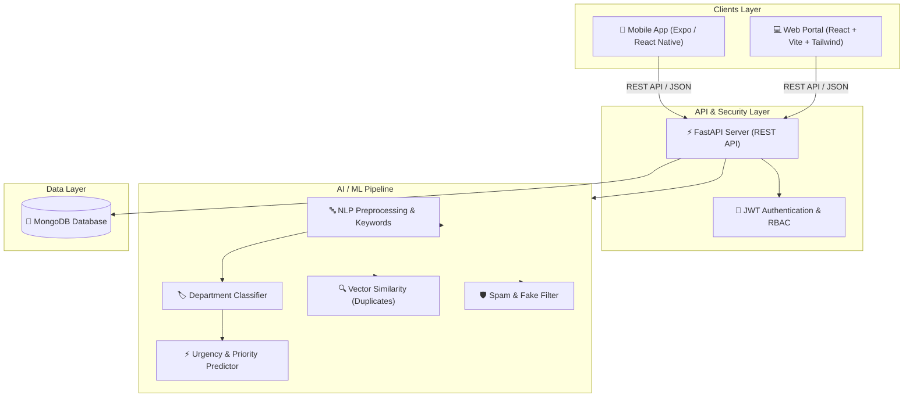

# 🏛️ AI-Based Citizen Grievance Classification & Prioritization System (GrievAI)

[](https://fastapi.tiangolo.com/)
[](https://www.python.org/)
[](https://react.dev/)
[](https://expo.dev/)
[](https://www.mongodb.com/)
[](https://tailwindcss.com/)
[](https://pytorch.org/)

An intelligent, multi-platform Smart City grievance management platform that leverages **Machine Learning (ML)** and **Natural Language Processing (NLP)** to automate grievance intake, categorization, urgency scoring, duplicate detection, and departmental routing. Built for municipal corporations, citizens, and administrative officers.

---

## 📌 Table of Contents

- [Overview](#-overview)
- [Key Features](#-key-features)
- [System Architecture](#-system-architecture)
- [Tech Stack](#-tech-stack)
- [Folder Structure](#-folder-structure)
- [Getting Started](#-getting-started)
  - [Prerequisites](#prerequisites)
  - [1. Backend Setup](#1-backend-setup)
  - [2. Frontend Web Setup](#2-frontend-web-setup)
  - [3. Mobile App Setup](#3-mobile-app-setup)
- [Environment Configuration](#-environment-configuration)
- [API Documentation](#-api-documentation)
- [Troubleshooting Common Issues](#-troubleshooting-common-issues)
- [License](#-license)

---

## 📖 Overview

Municipal and public grievance portals often suffer from manual bottlenecks: slow response times, misrouted complaints, duplicate submissions, and lack of real-time visibility. 

**GrievAI** addresses these challenges through an end-to-end AI-powered pipeline:
1. **Citizens** submit complaints via a web portal or mobile app with photos and geolocation.
2. The **AI/ML Engine** analyzes the text in real-time, predicts the appropriate municipal department, estimates priority level, detects spam/fake reports, and flags duplicate complaints.
3. **Officers & Administrators** monitor live GIS hotspot maps, oversee automated routing, track SLAs, and resolve complaints efficiently.

---

## ✨ Key Features

### 🧠 Intelligent AI / NLP Engine
- **Automated Department Classification**: Classifies unstructured text into relevant civic bodies (e.g., Road Maintenance, Water Supply, Electricity, Sanitation, Healthcare).
- **Dynamic Priority & Urgency Scoring**: Assesses severity based on sentiment, keywords (e.g., fire, hazard, leaking water), and location density.
- **Semantic Duplicate Detection**: Employs sentence embeddings (`sentence-transformers`) to detect and group identical or closely related complaints within geographic clusters.
- **Spam & Authenticity Verification**: Filters spam, gibberish, and fake grievance submissions before they reach civic workers.
- **Conversational AI Chatbots**: RAG-powered chatbot assisting citizens with grievance filing and admins with data querying.

### 🌐 Web Portal (Citizens & Administrators)
- **Role-Based Access Control (RBAC)**: Distinct dashboards for Citizens, Department Officers, and Super Admins.
- **Interactive GIS Map**: Visualizes grievance hotspots, clusters, and geolocation markers using Leaflet.
- **Live Analytical Dashboard**: Department resolution metrics, pending vs. resolved ratios, and priority distributions via Recharts.
- **Track & Review**: Real-time timeline tracker for submitted tickets with status updates.

### 📱 Cross-Platform Mobile App (GrievAI Mobile)
A production-ready React Native application built with **Expo SDK 58** and **TypeScript**, specifically designed for on-the-ground citizen participation and field officer operations:
- **Instant Photo & GPS Complaint Lodging**: Utilizes `expo-location` and `expo-image-picker` to capture geo-coordinates (latitude/longitude) and visual photo evidence right at the problem site.
- **AI-Powered Mobile Chatbot**: An in-app conversational assistant helping citizens file complaints naturally, inquire about grievance status, and understand municipal procedures.
- **Citizen Personal Dashboard**: View filed tickets, track resolution progress via a live interactive timeline (`Submitted` ➔ `In Review` ➔ `In Progress` ➔ `Resolved`), and access emergency contacts.
- **Field Officer Review System**: Dedicated mobile interface for municipal officers to inspect assigned tickets, review AI urgency scores and sentiment insights, add field remarks, and mark complaints as resolved on-site.
- **Hotspots & Civic Exploration**: Mobile view of city-wide complaint hotspots and recurring civic issue zones.
- **Standalone Android APK**: Configured with EAS Build (`eas.json`) for generating standalone distributable `.apk` packages.

*(For detailed mobile app documentation, see [`mobile/README.md`](mobile/README.md))*

---

## 🏗️ System Architecture



---

## 🛠️ Tech Stack

| Domain | Technology |
|---|---|
| **Backend Framework** | [FastAPI](https://fastapi.tiangolo.com/), Uvicorn (ASGI) |
| **Programming Language** | Python 3.11+ |
| **Database** | [MongoDB](https://www.mongodb.com/) with Motor (Async driver) |
| **Machine Learning & NLP** | PyTorch, Hugging Face Transformers, Sentence-Transformers, spaCy, NLTK, Scikit-Learn |
| **Web Frontend** | React 18, TypeScript, Vite, Tailwind CSS, Redux Toolkit, Framer Motion |
| **Mapping & Visuals** | Leaflet, React-Leaflet, Recharts, Lucide Icons |
| **Mobile Application** | React Native 0.88, Expo SDK 58, Expo Router, NativeWind |
| **Containerization** | Docker, Docker Compose |

---

## 📂 Folder Structure

```text
major-project/
├── backend/
│   ├── app/
│   │   ├── api/v1/          # Endpoints (auth, complaints, chat, analytics, etc.)
│   │   ├── core/            # Security, JWT, hashing utilities
│   │   ├── database/        # Motor MongoDB connection lifecycle
│   │   ├── ml/              # Classifier, duplicates, priority, sentiment, spam
│   │   ├── models/          # Pydantic schemas & MongoDB documents
│   │   └── services/        # Business logic, RAG, chatbot, reports
│   ├── run.py               # Uvicorn entry point (host 0.0.0.0, port 8000)
│   ├── requirements.txt     # Python backend dependencies
│   └── docker-compose.yml   # Multi-container setup with MongoDB
│
├── frontend/
│   ├── src/
│   │   ├── components/      # UI components (Navbar, ComplaintMap, Chatbot)
│   │   ├── pages/           # Pages (Dashboard, SubmitComplaint, Track, Admin)
│   │   ├── routes/          # Citizen & Admin protected routes
│   │   └── services/        # Axios / Fetch API client
│   ├── package.json
│   └── vite.config.ts
│
└── mobile/
    ├── src/
    │   ├── app/             # Expo file-based routes (login, submit, track, etc.)
    │   ├── components/      # Mobile UI widgets & dashboards
    │   └── context/         # AuthContext & API base URL state
    ├── app.json             # Expo application configuration
    └── package.json
```

---

## 🚀 Getting Started

### Prerequisites

Ensure you have the following installed on your development machine:
- **Python 3.10+ / 3.11**
- **Node.js 18+ & npm** (or yarn / pnpm)
- **MongoDB** running locally (`localhost:27017`) or a [MongoDB Atlas](https://www.mongodb.com/atlas) URI
- **Git**

---

### 1. Backend Setup

1. **Navigate to the backend directory**:
   ```bash
   cd backend
   ```

2. **Create and activate a virtual environment**:
   ```bash
   # Windows (PowerShell)
   python -m venv venv
   .\venv\Scripts\activate

   # macOS / Linux
   python3 -m venv venv
   source venv/bin/activate
   ```

3. **Install dependencies**:
   ```bash
   pip install --upgrade pip
   pip install -r requirements.txt
   ```

4. **Download the spaCy English model**:
   ```bash
   python -m spacy download en_core_web_sm
   ```

5. **Configure Environment Variables**:
   Create a `.env` file inside the `backend/` directory:
   ```env
   PROJECT_NAME="Smart City Citizen Grievance System"
   MONGODB_URL=mongodb://localhost:27017
   DATABASE_NAME=smart_city_grievance
   SECRET_KEY=your_super_secret_jwt_key_here
   ALGORITHM=HS256
   ACCESS_TOKEN_EXPIRE_MINUTES=10080
   ```

6. **Start the FastAPI server**:
   ```bash
   python run.py
   ```
   * The API server will be available at: **`http://localhost:8000`**
   * Interactive Swagger API Docs: **`http://localhost:8000/docs`**
   * Redoc Documentation: **`http://localhost:8000/redoc`**

---

### 2. Frontend Web Setup

1. **Navigate to the frontend directory**:
   ```bash
   cd ../frontend
   ```

2. **Install frontend dependencies**:
   ```bash
   npm install
   ```

3. **Configure Environment (Optional)**:
   Create a `.env` file inside `frontend/`:
   ```env
   VITE_API_URL=http://localhost:8000/api/v1
   ```

4. **Start the Vite development server**:
   ```bash
   npm run dev
   ```
   * Open your browser at: **`http://localhost:5173`**

---

### 3. Mobile App Setup

1. **Navigate to the mobile directory**:
   ```bash
   cd ../mobile
   ```

2. **Install mobile dependencies**:
   ```bash
   npm install
   ```

3. **Configure Laptop Wi-Fi IP**:
   * Open terminal and find your machine's local IPv4 address using `ipconfig` (Windows) or `ifconfig` (Mac/Linux).
   * Update the backend URL in `mobile/src/context/AuthContext.tsx`:
     ```ts
     export const API_URL = process.env.EXPO_PUBLIC_API_URL || 'http://<YOUR_LAPTOP_IP>:8000/api/v1';
     ```

4. **Start Expo Development Server**:
   ```bash
   npx expo start
   ```
   * Scan the generated QR code using the **Expo Go** app on Android or iOS (Ensure your phone and laptop are connected to the **same Wi-Fi network**).

---

## ⚙️ Environment Configuration

| Variable | Default Value | Description |
|---|---|---|
| `MONGODB_URL` | `mongodb://localhost:27017` | MongoDB connection string |
| `DATABASE_NAME` | `smart_city_grievance` | MongoDB database name |
| `SECRET_KEY` | *(Secret String)* | Key used for signing JWT tokens |
| `ALGORITHM` | `HS256` | JWT encryption algorithm |
| `ACCESS_TOKEN_EXPIRE_MINUTES` | `10080` (7 days) | Session validity lifetime |
| `VITE_API_URL` | `/api/v1` | Backend URL for web client proxy |
| `EXPO_PUBLIC_API_URL` | `http://<IP>:8000/api/v1` | Backend API URL for mobile app |

---

## 🔌 API Documentation

Once the backend is running, explore all endpoints interactively at `http://localhost:8000/docs`. Key routes include:

| Method | Endpoint | Description |
|---|---|---|
| `POST` | `/api/v1/auth/register` | Register a new Citizen or Officer |
| `POST` | `/api/v1/auth/login` | Authenticate user & return JWT token |
| `GET` | `/api/v1/auth/me` | Fetch authenticated user profile |
| `POST` | `/api/v1/complaints/` | Submit a new complaint (triggers ML pipeline) |
| `GET` | `/api/v1/complaints/public` | Public feed of verified grievances |
| `GET` | `/api/v1/complaints/{id}` | Retrieve individual complaint details |
| `PATCH`| `/api/v1/complaints/{id}/status` | Update resolution status & assign officer |
| `GET` | `/api/v1/analytics/hotspots` | Fetch geolocated grievance clusters for GIS map |
| `POST` | `/api/v1/chat/message` | Query the RAG-assisted grievance AI chatbot |

---

## ❓ Troubleshooting Common Issues

### 1. `en_core_web_sm` SSL Certificate Error
If downloading the spaCy language model fails with an SSL/certificate error on Windows or behind firewalls:
```bash
pip install --upgrade certifi
pip install https://github.com/explosion/spacy-models/releases/download/en_core_web_sm-3.7.1/en_core_web_sm-3.7.1-py3-none-any.whl --trusted-host github.com --trusted-host objects.githubusercontent.com
```

### 2. Mobile App "Network Request Failed" / Cannot Connect
- **Check Backend**: Verify the backend is actively running (`python run.py`) and listening on `0.0.0.0:8000`.
- **Same Wi-Fi**: Verify that both your phone and laptop are connected to the exact same Wi-Fi router or hotspot (not on mobile data).
- **IP Mismatch**: Verify the IP in `mobile/src/context/AuthContext.tsx` matches the current IPv4 address displayed by `ipconfig`.
- **Windows Firewall**: If Windows Firewall blocks incoming port 8000 requests, allow Python / port 8000 in Windows Defender Firewall settings.

---

## 📜 License

This project is developed for educational and research purposes as part of the Major Project curriculum. All rights reserved.

